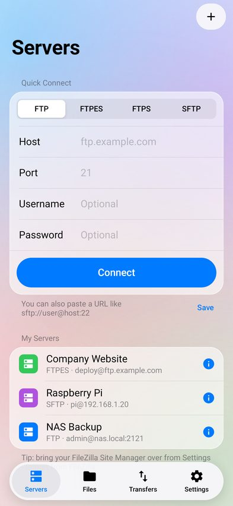
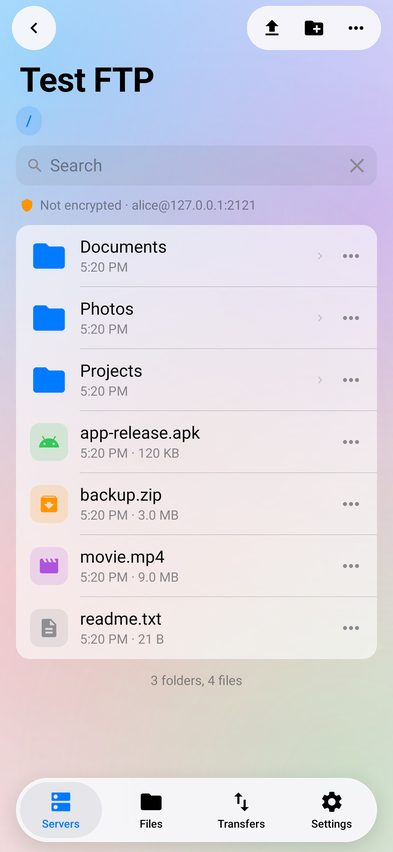
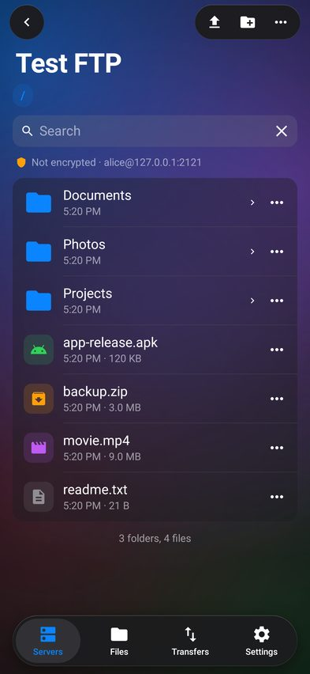
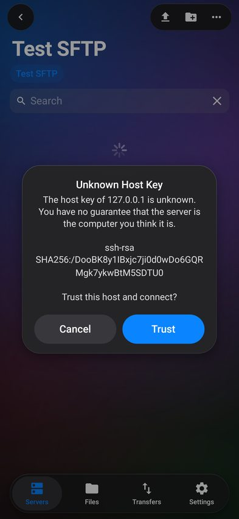
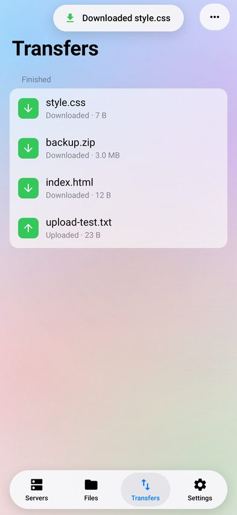

# Glass FTP

A FileZilla-style FTP / FTPS / SFTP client for Android with a liquid-glass interface that follows Apple's Human Interface Guidelines.

**[⬇️ Download the APK](dist/GlassFTP.apk)** · Android 8.0+ (API 26)

| Servers | Browser | Dark | Host key check | Transfers |
|---|---|---|---|---|
|  |  |  |  |  |

## فارسی

یک کلاینت FTP کامل برای اندروید با طراحی شیشه‌ای (Liquid Glass) بر اساس استانداردهای طراحی Apple.

- **پروتکل‌ها:** FTP، FTPES (TLS صریح)، FTPS (TLS ضمنی)، SFTP (با رمز عبور یا کلید خصوصی)
- **مدیر سایت** مثل FileZilla و **وارد کردن مستقیم `sitemanager.xml` از FileZilla**
- **اتصال سریع** (می‌توانید آدرسی مثل `sftp://user@host:22` را وارد کنید)
- **صف انتقال** با چند اتصال هم‌زمان، سرعت، زمان باقی‌مانده، لغو و تلاش دوباره، ادامه دانلود/آپلود نیمه‌کاره
- دانلود و آپلود **کل پوشه‌ها**، ادامه انتقال در پس‌زمینه با اعلان
- ساخت پوشه، تغییر نام، حذف، **تغییر مجوزها (chmod)**، اطلاعات فایل، جستجو و مرتب‌سازی
- **ویرایش مستقیم فایل‌های متنی** روی سرور (مثل View/Edit در FileZilla)
- **گزارش پیام‌ها** (دستورها و پاسخ‌های سرور)
- بررسی گواهی TLS و کلید میزبان SSH و به خاطر سپردن سرورهای مورد اعتماد
- رمزها با Android Keystore رمزنگاری می‌شوند
- پشتیبانی از نام فایل فارسی (UTF-8 و Windows-1256)، رابط فارسی و راست‌به‌چپ، حالت روشن و تیره

## Features

- **Protocols:** FTP, FTPES (explicit TLS), FTPS (implicit TLS), SFTP (password, keyboard-interactive or OpenSSH/PEM private key)
- **Site Manager** with one-tap connect, plus **import of FileZilla's `sitemanager.xml`**
- **Quick Connect**, including URLs such as `sftp://user@host:2222`
- **Transfer queue** in the FileZilla style: each worker has its own connection, 1–5 simultaneous transfers, speed/ETA, cancel/retry, resume, a choice of overwrite / resume / keep both / skip, and recursive folder upload and download
- Transfers keep running in the background (foreground service with progress notification, Wi‑Fi lock)
- Browsing: breadcrumbs, search, sort, hidden files, multi-select, new folder, rename, delete (recursive), **chmod**, file info, copy path
- **Edit remote text files** in place: download, edit, then save back to the server
- Open or share remote files with other apps, and upload from the system file picker or from device storage
- **Message log** with commands, replies and errors (passwords are masked)
- Trust-on-first-use for TLS certificates and SSH host keys, with a strong warning if a host key changes
- Passwords and keys are encrypted with the Android Keystore
- Persian and Arabic filename encodings (UTF-8, Windows-1256), a full Persian UI with right-to-left layout, light and dark themes

### Design

The UI is built with Android framework views only (no AndroidX), drawn to match Apple's HIG: SF-style type scale, iOS system colors, inset-grouped lists, a floating capsule tab bar, circular glass toolbar buttons, large titles that collapse into the navigation bar, action sheets and alerts. On Android 12+ the bars and sheets use a **real backdrop blur** of the content behind them (RenderNode + RenderEffect). Older versions fall back to a frosted tint.

## Building

**Android Studio / Gradle** (needs the Android SDK):

```bash
./gradlew assembleRelease     # app/build/outputs/apk/release/
```

GitHub Actions builds the APK on every push (see `.github/workflows/android.yml`).

**Without an Android SDK:** `tools/offline-build/build.sh` builds a signed APK using only Maven Central and npm (pinned, checksummed `aapt2`, `d8`, `apksigner`, `android.jar` and the Kotlin compiler). This script produced `dist/GlassFTP.apk`.

Both builds sign with the public debug key in `tools/offline-build/glassftp-debug.jks`. Use your own key for store releases.

## Project layout

```
app/src/main/java/com/glassftp/
  core/       FTP/FTPS (Apache Commons Net), SFTP (JSch), site store, trust store, FileZilla import
  transfer/   transfer queue + foreground service
  ui/         glass toolkit: backdrop blur, controls, navigation, alerts and sheets
  ui/screens/ servers, site editor, remote and local browsers, transfers, settings, log, editor
```

## Credits

The workflow (Site Manager, transfer queue, message log, file permissions dialog) is modelled on [FileZilla](https://filezilla-project.org). No FileZilla code is included. FileZilla is GPL-licensed C++, and the protocols here use [Apache Commons Net](https://commons.apache.org/proper/commons-net/) (Apache 2.0) and [JSch](https://github.com/mwiede/jsch) (BSD).
